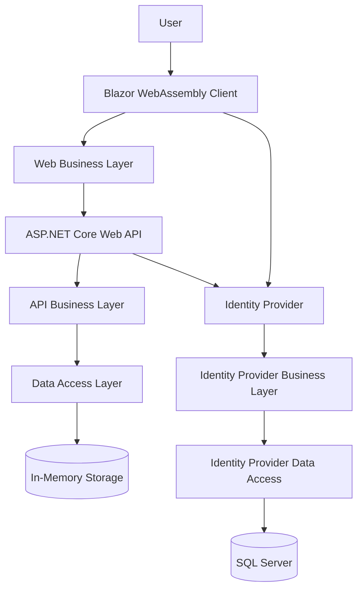

# Flashcards

A web-based flashcard application for creating, organizing and studying learning materials. Users can create flashcards, group them into collections and use them in interactive study sessions.

The project was developed collaboratively as part of a university software engineering course. It focuses on a modular application architecture, separation of concerns, authentication and automated testing.

## Features

- **Flashcard management** – create, edit and organize individual flashcards
- **Collections** – group flashcards into collections for easier organization
- **Study sessions** – practice flashcards through an interactive study interface
- **Lesson tracking** – record study sessions and access learning statistics
- **User management** – manage application users and their roles
- **Authentication and authorization** – authenticate users through a separate identity provider and protect API endpoints
- **Pagination and filtering** – retrieve collections and other resources using query parameters
- **Admin functionality** – provide additional functionality for users with administrative privileges

## Architecture

The solution is divided into several projects, separating the web client, API, business logic, data access and identity management.



### Main components

| Component | Responsibility |
|---|---|
| `Flashcards.Web.App` | Blazor WebAssembly user interface |
| `Flashcards.Web.BL` | Client-side business logic and API communication |
| `Flashcards.Api.App` | ASP.NET Core API and HTTP endpoints |
| `Flashcards.Api.BL` | Application business logic, facades, mapping and security services |
| `Flashcards.Api.DAL.Common` | Repository interfaces and shared data access abstractions |
| `Flashcards.Api.DAL.Memory` | In-memory implementation of API data storage |
| `Flashcards.IdentityProvider.App` | Identity server application and authentication endpoints |
| `Flashcards.IdentityProvider.BL` | Identity-related business logic |
| `Flashcards.IdentityProvider.DAL` | Identity persistence using Entity Framework Core and SQL Server |
| `Flashcards.Common.Models` | Shared application models and DTOs |
| `Flashcards.Common` / `Flashcards.Common.BL` | Shared types, options and abstractions |

### Architectural approach

The application uses a layered architecture to separate responsibilities:

- **Endpoints** handle incoming HTTP requests and expose API functionality.
- **Facades** coordinate application operations and implement business logic.
- **Repositories** abstract data access behind interfaces.
- **Mappers** transform between data entities and application models.
- **Services** encapsulate cross-cutting functionality, including user context and security.

This structure helps keep individual components independent and makes the application easier to maintain and test.

## Authentication and Authorization

Authentication is handled by a separate identity provider built with **Duende IdentityServer** and ASP.NET Core Identity.

The application uses OpenID Connect for user authentication and JWT bearer tokens for securing API requests.

Authorization is based on user roles and resource ownership. The API includes security services that provide access to the current user context and enforce permissions for protected operations.

The identity provider uses Entity Framework Core with SQL Server for identity-related persistence.

## Technology Stack

| Area | Technologies |
|---|---|
| Backend | C#, ASP.NET Core, .NET 9 |
| Frontend | Blazor WebAssembly, Razor Components |
| Styling | Tailwind CSS |
| Authentication | Duende IdentityServer, ASP.NET Core Identity, OpenID Connect, JWT |
| Database | SQL Server, Entity Framework Core (Identity Provider) |
| API documentation | OpenAPI, NSwag |
| Testing | xUnit, NSubstitute, ASP.NET Core Test Host |
| CI/CD | Azure Pipelines |
| Cloud | Microsoft Azure (previous deployment) |

## Testing

The solution contains separate test projects for different application layers:

- **Unit tests** – test business logic independently of external dependencies.
- **Endpoint tests** – test API endpoints using ASP.NET Core's testing infrastructure.
- **Integration tests** – test data access implementations and their interactions.

The test projects use xUnit, with NSubstitute available for creating test doubles.

## Getting Started

### Prerequisites

- [.NET 9 SDK](https://dotnet.microsoft.com/download/dotnet/9.0)
- [Node.js and npm](https://nodejs.org/) (required for Tailwind CSS)
- SQL Server (required for the Identity Provider)

### Configuration

Before running the application locally, configure the API and Identity Provider connection settings.

The following configuration sections need to be reviewed:

- `ApiOptions` – API base URL used by the web client.
- `IdentityOptions` – identity provider authority, client configuration and scopes.
- Identity Provider database connection string – SQL Server connection details.

Use local configuration, environment variables or .NET User Secrets for sensitive values. Do not commit passwords, client secrets, signing keys or other credentials to source control.

The repository's deployment-specific URLs and credentials must be replaced with local values.

### Running the application

The solution file is `Flashcards.sln`.

Restore dependencies:

```bash
dotnet restore Flashcards.sln
```

Build the solution:

```bash
dotnet build Flashcards.sln
```

Run the Identity Provider, API and Web Client as separate applications, using the appropriate local configuration:

```bash
dotnet run --project Flashcards.IdentityProvider.App
```

```bash
dotnet run --project Flashcards.Api.App
```

```bash
dotnet run --project Flashcards.Web.App
```

The applications must be configured to communicate with each other before the complete system can be used.

### Running tests

Run all tests in the solution:

```bash
dotnet test Flashcards.sln
```

Individual test projects can also be executed separately.

## Deployment

The application was previously deployed to **Microsoft Azure** as part of the university project, using university-provided Azure credits.

The deployment is no longer active because the university account and associated credits are no longer available. The repository therefore does not currently provide a live demo.

## Project Context

This project was developed as a collaborative university assignment. Development was shared across the team, with members contributing to different application entities and architectural layers.

The project provided practical experience with:

- Designing and implementing a multi-project .NET solution
- Separating business logic from data access
- Building REST API endpoints
- Implementing authentication and authorization
- Working with repositories, facades and dependency injection
- Writing unit, endpoint and integration tests
- Configuring CI/CD pipelines

---

**Note:** This project is an academic software engineering project and is not intended as a production-ready service.
